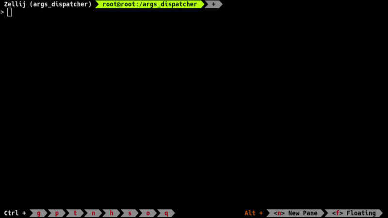

# args dispatcher

Header-only C library for building hierarchical command-line and REPL tools in
the style of [iproute2](https://wiki.linuxfoundation.org/networking/iproute2):
commands live in a tree of tables, are matched by exact name or unique
abbreviation, and take typed `keyword [value]` options. A one-shot CLI and an
interactive readline REPL can share the same command tree.

`src/` holds the library (`args.h` plus the logging macros in `debug.h`).
`examples/` holds demo frontends — a one-shot CLI (`example.c`) and a readline
REPL (`example_repl.c`) — over a demo command set (`ip`, `chassis`, `power`,
`info`).

## Features

- Command tables: nested subcommands; one CLI binary or an interactive REPL
  over the same tree.
- Abbreviations: `ip a a 10.0.0.1/24 d eth0` is `ip addr add 10.0.0.1/24 dev
  eth0`. An exact match always wins; ambiguous abbreviations are rejected.
- Keyword/value options: required options, flags without values, duplicate
  detection, free order — the way `ip route ... via ... dev ... onlink` works.
- Optional readline tab-completion: command names, keywords (already used ones
  are not offered again), per-command help when the line is complete.
- Single header, C11, only libc; no heap allocations in the dispatcher
  (completion builds its match lists with `malloc`, as readline requires).

## Repository layout

| path                  | what                                                       |
| --------------------- | ---------------------------------------------------------- |
| `src/args.h`          | the library (include this)                                  |
| `src/debug.h`         | logging macros used by `args.h` and the demo                |
| `examples/example.c`      | one-shot CLI frontend                                       |
| `examples/example_repl.c` | interactive REPL frontend (readline)                        |
| `examples/commands/`      | demo command implementations (`ip.h` is the most complete)  |
| `tests/run.sh`            | test suite: CLI, REPL, completion, ASan/UBSan, leak checks  |
| `tests/example_test.c`    | synthetic-table dispatcher tests                            |
| `Config.in`               | Buildroot package fragment (package name `example`)         |

## Build, test, install

```sh
make           # build/example, build/example_repl (needs libreadline)
make test      # 200+ cases; uses ASan/UBSan when available
make install   # PREFIX defaults to /usr/local
```

## A minimal CLI

```c
/* mycli.c */
#include <stdio.h>
#include "args.h"

static int led_off ( args_context_t *ctx )
{
	(void) ctx;
	printf ( "led off\n" );
	return 0;
}

static int led_on ( args_context_t *ctx )
{
	(void) ctx;
	printf ( "led on\n" );
	return 0;
}

static args_command_t led_table[] = {
	{ "off", led_off, NULL, 0, "Switch the LED off", NULL },
	{ "on",  led_on,  NULL, 0, "Switch the LED on",  NULL },
	{ NULL, NULL, NULL, 0, NULL, NULL },
};

static const args_command_t led = { .name = "led", .next = led_table };

static args_command_t root[] = {
	led,
	{ .name = NULL },
};

int main ( int   argc,
	   char *argv[] )
{
	char  buf[MAX_LINE];
	char *line = args_parse ( buf, sizeof ( buf ), argc, argv );
	if ( line == NULL )
		return 1;

	args_argv_t    av;
	args_context_t ctx = { .av = &av, .line = line, .command = root };

	if ( args_tokenize ( &ctx ) == 0 || args_dispatch ( &ctx ) < 0 )
		return 1;

	return 0;
}
```

```console
$ ./mycli led on
led on
$ ./mycli l on         # abbreviations work at every level
led on
```

## API

### Command tables

The tree is made of `args_command_t` arrays, each terminated by an entry with
`name == NULL`:

```c
struct args_command_t
{
	const char     *name;   /* keyword: exact match, else unique prefix      */
	int ( *fn ) ( args_context_t *ctx ); /* handler; NULL for a group      */
	args_command_t *next;   /* subcommand table; == own table: repeatable   */
	size_t          args;   /* positional args consumed before fn runs      */
	const char     *help;   /* one-liner, shown by help and usage errors    */
	args_keyword_t *kw;     /* "keyword [value]" options, may be NULL       */
};
```

- A node with `fn` runs when the input reaches it. The handler reads its
  positional arguments starting at `ctx->av->tokens[ctx->idx]`; their count is
  the node's `args` field.
- A node with `next` descends into a sub-table. A `next` pointing to the table
  the node itself lives in (a "self-loop") makes the command repeatable, e.g.
  `info show show` — see `examples/commands/info.h`.
- `fn == NULL && next == NULL` is a configuration error and is reported as
  such at dispatch time.

### Handlers

```c
int handler ( args_context_t *ctx );
```

Return 0 on success; return < 0 to abort dispatch with an error. Useful
`args_context_t` fields inside a handler:

| field       | meaning                                                  |
| ----------- | -------------------------------------------------------- |
| `av`        | tokenized line (`tokens` + `count`)                      |
| `idx`       | index of the handler's first positional argument         |
| `command`   | the matched command (e.g. to reach its `kw` table)       |
| `data`      | free pointer for application state                       |
| `depth`     | current subcommand depth (for indentation)               |
| `repl`      | non-NULL only in a REPL                                  |

### Keyword options

```c
enum { RT_VIA, RT_DEV, RT_ONLINK, RT_N };

static args_keyword_t kw[] = {
	[RT_VIA]    = { "via",    0, 0, NULL }, /* takes a value, optional     */
	[RT_ONLINK] = { "onlink", 1, 0, NULL }, /* flag: no value, "" when set */
	[RT_DEV]    = { "dev",    0, 1, NULL }, /* required                    */
	[RT_N]      = { NULL },
};

static int route_add ( args_context_t *ctx )
{
	args_keyword_t *kw = ctx->command->kw;

	if ( args_parse_keyword ( ctx ) != 0 )
		return -1; /* unknown, ambiguous, duplicated or missing keyword */

	if ( kw[RT_DEV].val != NULL )
		; /* keyword was given, .val holds its value */

	return 0;
}
```

`args_parse_keyword()` parses everything after the positional arguments.
Keywords may be abbreviated to a unique prefix (`d eth0` = `dev eth0`), an
exact match always wins, duplicates and unknown keywords are errors. After a
successful call, `.val` holds the value, `""` for a given flag, and `NULL`
for an absent keyword.

Helper for numeric values: `args_parse_uint ( s, min, max, &out )` — rejects
empty strings, signs, non-digits and out-of-range values.

### Matching

`args_find ( token, array, type, field, n )` — the lookup used everywhere —
compares `token` against the `field` of each element of an array of `type`:
an exact match wins, otherwise a unique prefix is accepted. Returns the
element index, `ARGS_NONE` or `ARGS_AMBIGUOUS`. Pass `n == ARGS_NT` for a
NULL-terminated array.

### Driving the dispatcher

```c
char  buf[MAX_LINE];
char *line = args_parse ( buf, sizeof ( buf ), argc, argv ); /* join argv */
args_context_t ctx = { .av = &av, .line = line, .command = root };

if ( args_tokenize ( &ctx ) == 0 ) /* empty line */
	/* show usage */;

args_dispatch ( &ctx ); /* 0 ok, -1 error */
```

- `args_parse()` joins `argv` into one line, or returns NULL when it does not
  fit `MAX_LINE`. The line can come from anywhere (REPL, config file) as long
  as the buffer is writable — tokenizing modifies it in place.
- `args_tokenize()` splits on whitespace (at most `MAX_TOKENS` tokens).
- `args_help ( FILE *out, table, depth )` prints a table and its sub-tables.

### REPL and tab-completion

```c
#define ARGS_REPL /* pulls in readline and the completion code */
#include "args.h"

static args_context_repl_t repl = { .root = root };
static args_argv_t         av;
static args_context_t      ctx = { .av = &av, .repl = &repl };

static char **complete ( const char *text,
			 int         start,
			 int         end )
{
	(void) end;
	return args_complete ( &ctx, rl_line_buffer, text, start );
}

/* in main(): */
rl_attempted_completion_function = complete;
```

`args_complete()` completes command names and keyword names, and shows
per-command help when the cursor sits past a complete command or a keyword
value. Reset `ctx.line`, `ctx.command`, `ctx.idx` (and friends) for every
input line, as `examples/example_repl.c` does.

### Diagnostics and exit status

Diagnostics and the demo output go to stdout through the `log()` / `log_info()`
macros (`src/debug.h`), indented by dispatch depth. `args_dispatch()` returns
-1 on any error — unknown or ambiguous command, usage error, failed handler —
and 0 on success; the `example` frontend maps that to exit status 1 and 0.

## Limitations (known issues)

- Tokenizing splits on whitespace only: no quoting (`"a b"` becomes two
  tokens).
- Input is capped at `MAX_TOKENS` (32) tokens and `MAX_LINE` (256) bytes;
  excess input is rejected or truncated rather than reported precisely.
- Extra tokens after a command with no subcommands are silently ignored.
- No built-in `-h` / `--help` handling.
- Matching is case-sensitive.

## License

GPL-2.0-or-later, see [LICENSE](LICENSE). Note that the REPL frontend links
against GNU readline (GPL).
